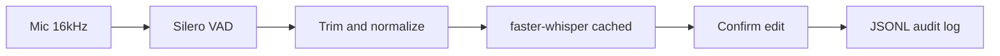

# Local Voice Agent

Local, offline-capable **speech-to-text with human confirm/edit** — no cloud STT API keys on the default CLI path. Record from your mic, review the transcript, fix mistakes, then use the confirmed text in your own tools or scripts.

Built by [Hrutik Pisal](https://github.com/HrutikPisal). MIT License.

## Features

- **Silero VAD** endpointing + optional manual stop (Ctrl+R on native Windows console)
- **faster-whisper** STT with **cached** `small` model, beam search, and configurable initial prompt
- **Audio prep** — trim silence padding, RMS normalize before decode
- **Confirm/edit step** — security and ground truth before any downstream automation
- **JSONL audit logs** — per-turn timings, STT confidence, edit rate
- **Optional self-hosted LiveKit** — WebRTC + same STT/confirm UX (Apache 2.0 server you run)
- **Benchmarks** — `log_stats` on audit files; optional labeled WAV benchmark

## Requirements

- Python 3.10+
- Microphone
- CPU: plan for **~1–2 GB RAM** while running with default `small` Whisper (model stays loaded between `.talk` turns)
- First run downloads Whisper weights via faster-whisper (network once)

## Quick start

```bash
git clone https://github.com/HrutikPisal/local-voice-agent.git
cd local-voice-agent
pip install -r voice/requirements-stt.txt
python -m voice
```

At the REPL:

1. Type **`.talk`** and speak.
2. Review the transcript — press Enter to accept, type corrections, or **`.cancel`** to discard.
3. Confirmed text prints as **`[CONFIRMED INPUT]`**.
4. Type **`exit`** to quit.

The banner shows the audit log path (`logs/voice_<DD_MM_YYYY>.txt`).

Override Whisper size: `python -m voice --stt-model base` (lower RAM).

## Architecture



Details: [docs/ARCHITECTURE.md](docs/ARCHITECTURE.md).

## Install profiles

| File | Purpose |
| --- | --- |
| [voice/requirements-stt.txt](voice/requirements-stt.txt) | Mic + VAD + Whisper (default) |
| [voice/requirements-livekit.txt](voice/requirements-livekit.txt) | STT + LiveKit Agents |
| [voice/requirements-full.txt](voice/requirements-full.txt) | Optional Piper/Ollama demos (legacy) |

## LiveKit (optional)

For browser/WebRTC transport with the same local STT and confirm/edit flow:

```bash
cd voice/livekit
docker compose up -d
pip install -r voice/requirements-livekit.txt
copy .env.example .env.local   # Windows; use cp on macOS/Linux
python -m voice.livekit console
```

See [voice/livekit/README.md](voice/livekit/README.md). LiveKit Cloud is **not** required.

## STT tuning

Edit [voice/config.json](voice/config.json) and restart `python -m voice`. Reference: [docs/STT_TUNING.md](docs/STT_TUNING.md).

## Measurement

Summarize edit rate and timings from audit logs:

```bash
python -m voice.tools.log_stats
```

Optional WER benchmark — add 16 kHz mono WAVs under `voice/tests/fixtures/samples/` and update `stt_manifest.json`:

```bash
python -m voice.benchmark_stt
```

## Tests

```bash
python -m unittest discover -s voice/tests -p "test_*.py"
```

## Related: LocalCLIagent

This voice stack is also vendored in [LocalCLIagent](https://github.com/HrutikPisal/LocalCLIagent) for integration with a local tool-using CLI agent. **Phase 2 (planned there):** wire `[CONFIRMED INPUT]` into the main CLI after user approval.

Use **this repo** for voice-specific issues, docs, and releases.

## License

MIT — see [LICENSE](LICENSE).
