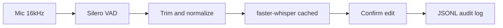

# Architecture

Cascaded local voice input (no cloud STT API keys on the default CLI path):

| Stage | Module | Library |
| --- | --- | --- |
| Capture + endpoint | `voice/recorder.py` | sounddevice + Silero VAD |
| Audio prep | `voice/audio_prep.py` | numpy |
| STT | `voice/stt.py` | faster-whisper |
| UX | `voice/transcript_confirm.py` | stdin confirm/edit |
| Logging | `voice/logger.py` | `logs/voice_<date>.txt` |

Optional **LiveKit** path: self-hosted `livekit-server` + `voice/livekit/` agent worker; same STT engine and confirm/edit UX in the worker terminal.

Design notes: [voice/how_to_build_voice_Agent](../voice/how_to_build_voice_Agent).
