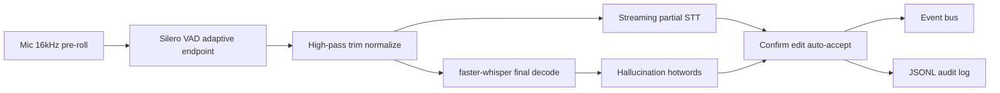

# Architecture

Cascaded local voice input (no cloud STT API keys on the default CLI path):

| Stage | Module | Library |
| --- | --- | --- |
| Capture + endpoint | `voice/recorder.py` | sounddevice + Silero VAD + adaptive grace |
| Streaming partials | `voice/streaming_stt.py` | faster-whisper (beam 1, rolling window) |
| Audio prep | `voice/audio_prep.py` | numpy + optional high-pass / noise gate |
| STT engine | `voice/stt_engine.py` | faster-whisper (default), optional sherpa-onnx / Moonshine |
| STT facade | `voice/stt.py` | filters + hotwords + preload/warmup |
| UX | `voice/transcript_confirm.py` | confirm, `.rerecord`, `.append`, auto-accept |
| Integration | `voice/events.py`, `voice/agent_bridge.py` | hooks for CLI agent / LLM / TTS |
| Logging | `voice/logger.py` | `logs/voice_<date>.txt` |

Startup: `voice/main.py` preloads the STT engine in a background thread and runs a short warm-up decode so the first `.talk` avoids cold-start latency.

Optional **LiveKit** path: self-hosted `livekit-server` + `voice/livekit/` agent worker; same STT engine and confirm/edit UX in the worker terminal.

## Benchmarking

| Tool | Purpose |
| --- | --- |
| `python -m voice.benchmark_stt` | WER on labeled WAV fixtures |
| `python -m voice.benchmark_engines` | Compare model sizes (`base.en`, `small.en`, …) |
| `python -m voice.tools.build_stt_fixtures` | Regenerate fixture WAVs (Windows SAPI) |
| `python -m voice.tools.log_stats` | Edit rate and timings from audit logs |

Design notes: [voice/how_to_build_voice_Agent](../voice/how_to_build_voice_Agent).